# Kim's ZMK Config

## Keymap



## Local Building

```bash
# Install dependencies using mise
mise install

# Init the build environment
just init

# Show all recipes
just help

# Build all boards
just build

# Show all build targets
just list

# Build a specific board
just build corney_right
```

### Use local zephyr modules

You can use local repos of modules by defining them in:

```bash
# Copy the example file
cp mise.local.toml.example mise.local.toml

# Edit it to point modules to local repos
vim mise.local.toml

# Show module overrides
just local-modules

# Clean the build dir after changing modules
just clean

# Build a board
just build corney_right
```
